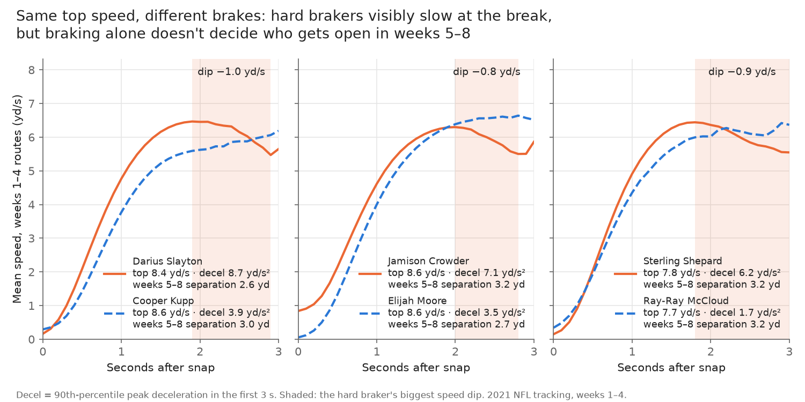
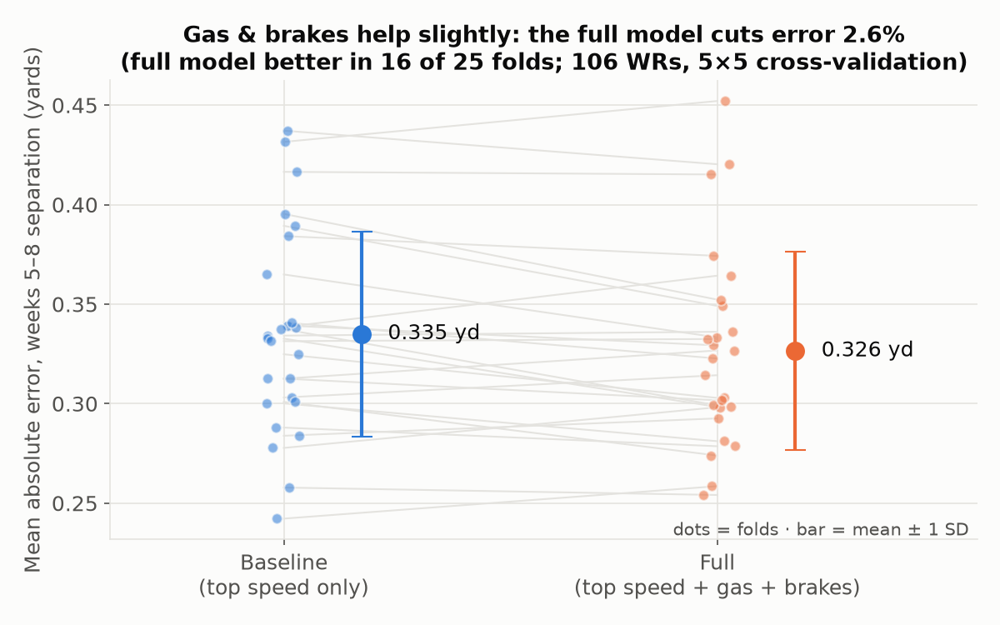
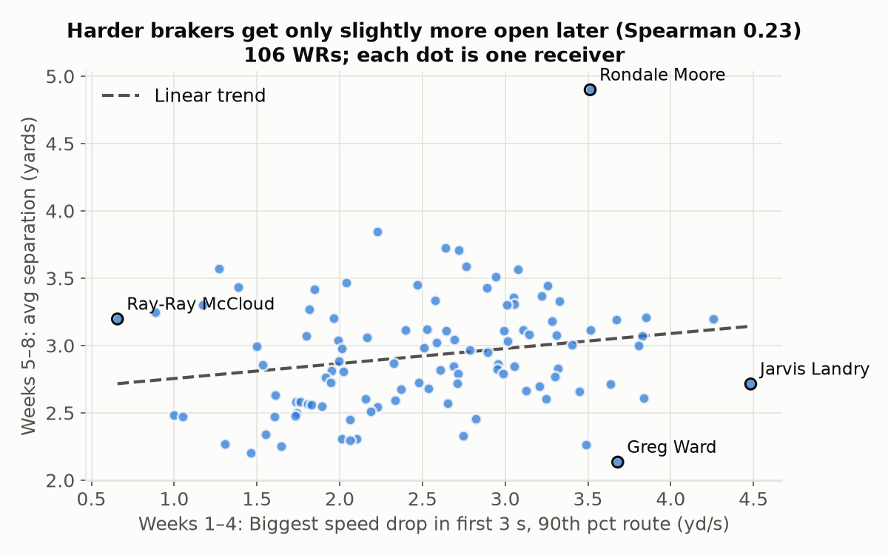

# Gas or Brakes: Does how a receiver stops predict how open he gets?

Leonardo Villalobos & Alex Oh · NFL Big Data Bowl NYU Edition (2021 season, weeks 1–8)

How hard a receiver brakes in weeks 1–4 predicts his separation in weeks 5–8 [X%] better than his top speed does ([MAE full] vs. [MAE baseline] yards, full model wins [N] of 25 folds; top feature: [feature]). We built per-route speed curves for [N_PLAYERS] [WRs] from player tracking, measured "gas" (speed and peak acceleration in the first second) and "brakes" (peak deceleration and largest speed drop in the first 3 seconds), and compared the same [TabPFN] model with and without them using 5-fold cross-validation repeated 5 times, split by player. Scouts and coaches could rank receivers by a Brake Score instead of 40-time-style top speed when projecting who will get open. Separation is measured to the nearest defender at 2.5 s after the snap (or at the throw if earlier); braking depends partly on the route tree a player is asked to run; and the sample is eight weeks of one season.

## Same top speed, different brakes



## Does adding gas and brakes beat top speed?



## Brakes in weeks 1–4 vs. separation in weeks 5–8



## How to run

1. Download the event data from [nfl-big-data-bowl-regional-event-data](https://github.com/ThompsonJamesBliss/nfl-big-data-bowl-regional-event-data) into `data/raw/` (so `data/raw/games.csv`, `data/raw/tracking/…`).
2. `pip install -r requirements.txt`
3. From the repo root, run in order:
   ```
   python src/01_build_routes.py
   python src/02_player_metrics.py
   python src/03_models.py
   python src/04_charts.py
   python src/05_speed_curves.py
   ```

Results tables are in `outputs/tables/`, charts in `outputs/figures/`.
